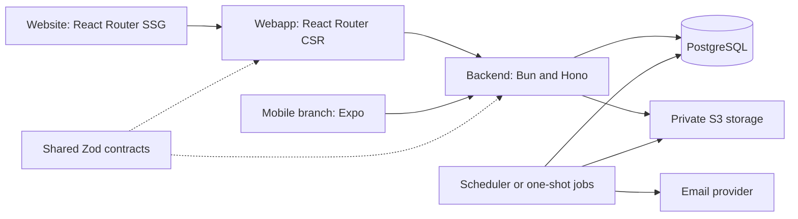

# Vibe Coding Template



A web product template for work with coding agents. The `mobile` branch adds an Expo application.

<!-- BOOTSTRAP_ONLY_START -->
## Prompt to copy to your agent

```text
Set up https://github.com/di-sukharev/vibe as the base for a new project.
Before cloning, ask whether mobile is needed. Use mobile for yes and master for no.
Read AGENTS.md and follow "Agent setup instructions" in README.md.
Communicate in my language.
```

## Agent setup instructions

Use this section only when creating a new project. Keep it and `CHECKLIST.md` when maintaining the template.

1. Ask whether mobile is needed before cloning. Select `master` or `mobile`. For mobile, clone the full history and fetch both branches. Run `git merge-base --is-ancestor origin/master origin/mobile`. If it fails, stop. The template owner must merge `master` into `mobile` first.
2. Use [CHECKLIST.md](CHECKLIST.md) to collect product and setup choices in the user's language. Ask only applicable questions. Choose technical details yourself.
3. Remove the template remote with `git remote remove origin`. Add a new remote only from the user's repository address or request to publish. Never publish a product to the template repository.
4. Install with the Bun version in `package.json`. Configure the selected applications from their `.env.example` files. Generate `JWT_SECRET` locally. Keep secrets out of Git and tool output. Leave unselected applications unconfigured.
5. Set branding in `theme.json` and run `bun run theme`. Rename the template identifiers in packages, databases, cookies, Docker configuration, and page metadata. Search for `web_app_demo`, `web-app-demo`, `vibecoding-template`, and `Vibe Coding Template`. Regenerate `bun.lock` after package changes.
6. For mobile, select the user's Expo account and initialize EAS only when builds are needed. Do not configure Expo, EAS, or Maestro for a web-only project.
7. If deployment is requested, choose hosting from audience, data location, and operating needs. Use the independent static builds and backend image described in [Deployment](docs/DEPLOYMENT.md). Configure the chosen host in the new project.
8. Run the relevant checks and verify local startup. Keep required operating details in the project README and configuration. Delete `CHECKLIST.md` and this entire block, including its markers. Report local URLs, check results, and any remaining user actions.
<!-- BOOTSTRAP_ONLY_END -->

## Applications

| Path | Purpose | Guide |
| --- | --- | --- |
| `backend` | API, PostgreSQL, authentication, jobs, email, and files | [Backend](backend/README.md) |
| `webapp` | React Router CSR for signed-in users | [Webapp](webapp/README.md) |
| `website` | React Router SSG for public pages and SEO | [Website](website/README.md) |
| `packages/contracts` | Shared API schemas and types | [Contracts](packages/contracts/README.md) |
| `mobile` branch | Expo application | [Mobile](mobile/README.md) |

## Quick start

Use the Bun version in [package.json](package.json). Run commands from the repository root.

```bash
bun install --frozen-lockfile
bun run dev:webapp
bun run dev:website
```

Run each application in its own terminal. Authentication and data need the [backend and local PostgreSQL](backend/README.md#local-development). The website can run alone.

The backend permits only origins in `CORS_ORIGINS`. `localhost` and `127.0.0.1` are different origins. If refresh fails with a CORS error, check the webapp origin and restart the backend.

## Checks and operations

Package scripts define the available commands. [AGENTS.md](AGENTS.md) defines architecture and working rules. [CLAUDE.md](CLAUDE.md) imports those rules for Claude.

Run focused checks during development. `bun run check` runs the full local checks and needs Docker and package registry access.

[Testing](docs/TESTING.md) explains database tests and E2E. [UI](docs/UI.md) explains theme generation and screenshots. [Deployment](docs/DEPLOYMENT.md) covers production setup and recovery.

## License

Apache License 2.0. Keep [LICENSE](LICENSE) and [NOTICE](NOTICE) when distributing this template or a derived project. Preserve the attribution to Dima Sukharev, his GitHub account, and the source repository.
